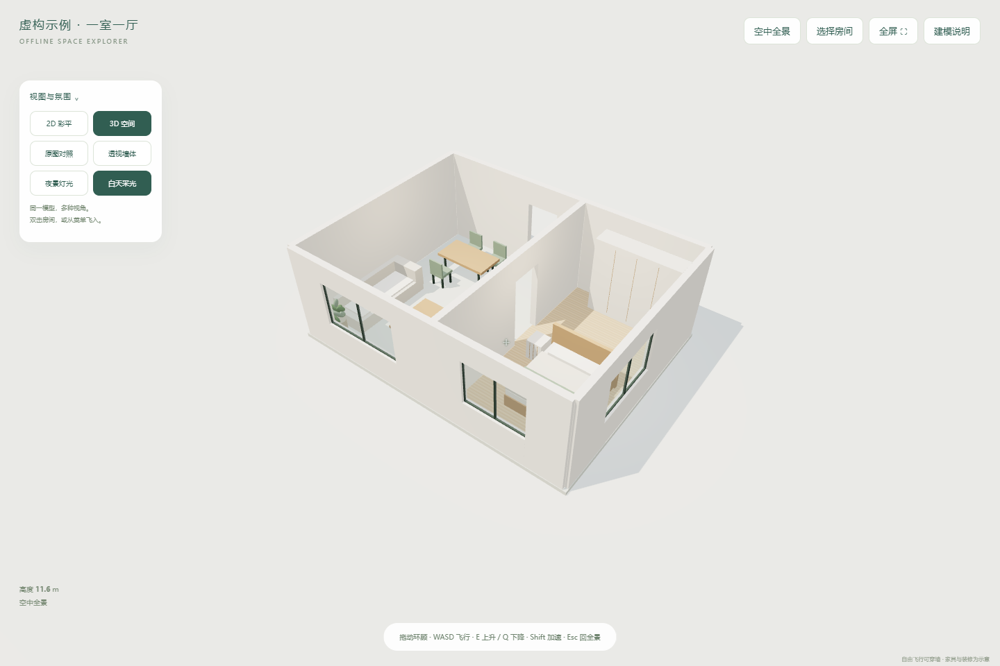

# Floorplan 3D Explorer · 户型神游 Skill

把带尺寸的户型图做成单文件、离线可打开的 3D 户型网页：鸟瞰 / 2D 彩平、自由飞行与房间进入、原图对照、透视墙体和昼夜灯光。打开直接显示全景，默认没有开场视频。

这是一个供 Codex 等 Agent 使用的 Skill；模型识别与尺寸核对由 Agent 完成，构建器读取结构化 JSON 生成网页，不包含自动识图模型。



## 使用

将此仓库目录放入 Agent 的 skills 目录，或使用兼容的 Skill 安装器。对 Codex 说：

> 使用 $floorplan-3d-explorer，把这张户型图做成能飞进房间的离线 3D 网页，不要开场视频。

不依赖网络即可构建虚构示例（需要 Node.js 18+）：

```sh
node scripts/build.mjs examples/demo.json --out demo.html
```

用 Edge / Chrome 打开生成的 `demo.html`。拖动环顾，WASD 飞行，E/Q 升降，Shift 加速；房间菜单飞入，Esc 返回全景。自由飞行可穿墙，手机有方向按钮。

数据格式见 [references/spec-format.md](references/spec-format.md)。开发者可修改 `assets/viewer.js`、CSS 和 HTML 扩展家具或视觉细节。浏览器验证脚本使用已有 Playwright 和浏览器，不自动安装依赖，见 [references/verification.md](references/verification.md)。

## 范围与隐私

图上尺寸和估算值分开标明。家具与夜景属于示意，不能作为施工图、结构安全结论或真实日照/照度计算。默认不联网、登录、发布或上传用户图片。示例为虚构户型，仓库不含使用者的原始户型图。

## 来源与许可

本 Skill 与模板采用 MIT 许可。Three.js r170 的原始许可保留于 [assets/vendor/THREE-LICENSE.txt](assets/vendor/THREE-LICENSE.txt)。

交互概念参考 [ZWD11/house-plan-designer](https://github.com/ZWD11/house-plan-designer) 的 2D/3D 联动、底图核对、透视墙与夜景预览；参考版本 `ab7bb1c52eeb0056bfff782ba71bb9f5faa1e1ab`，MIT。当前实现与数据格式独立编写，没有复制它的设计器模板。
